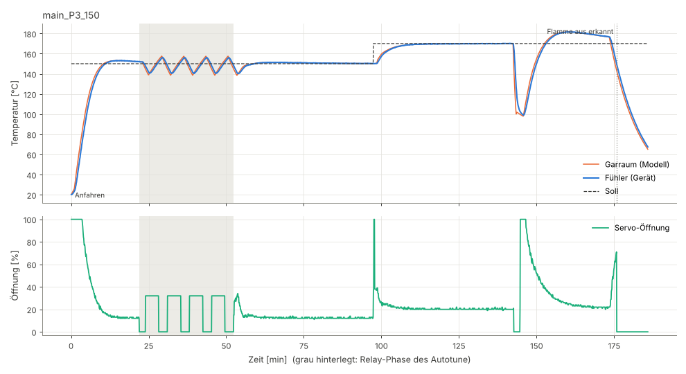

# Autotune und Sicherheitslogik: Offline-Simulation

Stand: Branch `feature/gas-servo-autotune`. Reproduzieren:

```bash
make -C test/sim test
```

Danach optional `python3 tools/plot_sim.py test/sim/out docs/sim` für die Plots.
Ergebnis: `ALL PASSED`, **170 Prüfungen** im Simulator plus 5 Unit-Tests der
Server-Antwort-Policy, zusätzlich 20 Durchläufe mit anderen Zufalls-Seeds ohne Fehler. Die Tests laufen in CI bei jedem Push mit (`.github/workflows/gas-ci.yml`).

## Was getestet wird

Der Simulator (`test/sim`) kompiliert den **echten Firmware-Code** auf dem PC:
`src/pitmaster/Pitmaster.cpp`, `PidCore.cpp`, `AutoTuneRelay.cpp` und `FlameOutDetector.cpp`.
Nachgebildet werden nur Arduino-Zeit, LEDC-PWM und der Temperaturkanal. Der Kanal läuft wie
`TemperatureBase` (Median aus 9 Werten bei 5 Hz, Refresh 1 Hz mit Gradientenfilter). Ausgewertet
wird der tatsächliche PWM-Wert am Servo-Pin und ob der Pin angekoppelt ist. Die Servo-Auflösung
von 1 % (Arduino `map()` mit `long`) ist dadurch automatisch enthalten.

### Streckenmodell (`test/sim/plant.*`)

| Größe | Modell |
|---|---|
| Ventil | `Tss(u) = tMin + (tMax − tMin) · √(u/100)`, u = Servo-Weg zwischen kleinster Stufe (0 %) und großer Flamme (100 %). Grundleistung bei kleinster Stufe = `tMin`. Nahe der kleinsten Stufe ändert wenig Weg viel. |
| Garraum | FOPDT: `τ · dT/dt = Tss(u(t − L)) − T` |
| Fühler | Verzögerung 1. Ordnung (10–30 s), Rauschen ±0,3 °C gleichverteilt |
| Deckel offen | zusätzlicher Verlust zur Umgebung mit τ = 90 s (bewusst hart: keine Wärmespeicherung in Wänden oder Fleisch) |
| Flamme aus | Heizleistung 0, Gas strömt weiter |
| Übertemperatur | zusätzliche Wärme (+80 °C stationär, z. B. Fettbrand) |

| Set | Totzeit L | Zeitkonstante τ | tMin (kleinste Stufe) | tMax (große Flamme) | Fühler |
|---|---|---|---|---|---|
| P1 klein/schnell | 20 s | 4 min | 70 °C | 220 °C | 10 s |
| P2 mittel | 40 s | 7 min | 75 °C | 250 °C | 20 s |
| P3 groß/träge | 60 s | 10 min | 80 °C | 280 °C | 30 s |

## Ergebnis Autotune + Regelung

Ablauf je Szenario:
1. Kaltstart bei 20 °C, Autotune explizit gestartet.
2. 30 min Übergabe, danach 15 min Halten.
3. Sollsprung +20 °C, gemessen über 45 min.
4. Deckel 60 s offen, danach 30 min Pause.
5. Flamme aus.

Alle Temperaturen sind Gerätewerte (`/data`), Rauschen eingeschlossen. Regel: Tyreus-Luyben (Default), d = 20 %, h = 1,5 °C.

| Szenario | AT ok | AT Zeit [min] | davon Relay [min] | Zyklen | Bias [%] | Tu [s] | a [°C] | Ku | Kp | Ki | Kd | Übergabe max [°C] | Halten max [°C] | Überschwingen +20 [°C] | nach Sprung max [°C] | Deckel Fehlalarm | Flamme aus erkannt [s] |
|---|---|---|---|---|---|---|---|---|---|---|---|---|---|---|---|---|---|
| P1_110 | ja | 22.0 | 12.1 | 4 | 8.8 | 167 | 5.66 | 3.24 | 1.47 | 0.0040 | 39.0 | 6.42 | 0.43 | 0.22 | 0.26 | nein | 128 |
| P2_110 | ja | 42.5 | 22.1 | 4 | 4.8 | 305 | 6.20 | 2.54 | 1.16 | 0.0017 | 55.9 | 5.74 | 0.43 | 0.35 | 0.31 | nein | 141 |
| P3_110 | ja | 58.5 | 34.1 | 4 | 2.9 | 472 | 6.81 | 2.14 | 0.97 | 0.0009 | 72.9 | 4.97 | 0.70 | 0.54 | 0.35 | nein | 141 |
| P1_150 | ja | 38.2 | 14.8 | 4 | 27.6 | 185 | 4.80 | 5.31 | 2.41 | 0.0059 | 71.0 | 6.36 | 0.35 | 0.32 | 0.36 | nein | 329 |
| P2_150 | ja | 39.8 | 24.6 | 4 | 19.7 | 320 | 7.65 | 3.31 | 1.50 | 0.0021 | 76.4 | 10.49 | 0.64 | 0.11 | 0.43 | nein | 139 |
| P3_150 | ja | 52.4 | 30.5 | 4 | 12.9 | 427 | 7.76 | 2.70 | 1.23 | 0.0013 | 83.1 | 9.92 | 0.69 | 0.21 | 0.40 | nein | 142 |
| P2_130 (minOutput 8 %) | ja | 61.7 | 49.3 | 4 | 12.3 | 656 | 4.28 | 3.61 | 1.64 | 0.0011 | 171.1 | 2.02 | 0.63 | −0.22 | 0.99 | nein | 129 |

Abnahme (die sechs Szenarien 110/150 °C × P1–P3):

| Kriterium | Ziel | Ergebnis |
|---|---|---|
| Autotune konvergiert, ab Kaltstart gemessen | ≤ 60 min | 22–58,5 min ✔ (P3_110 mit 1,5 min Reserve) |
| Überschwingen nach Sollsprung +20 °C | < 5 °C | max. 0,54 °C ✔ |
| stationär | ±2 °C | max. 0,70 °C beim Halten, 0,43 °C nach dem Sprung ✔ |
| Abbruchpfade enden mit Servo auf `minOutput` | ja | alle ✔ (siehe unten) |
| Flamme aus erkannt | ≤ 6 min | 128–329 s ✔ (P1_150: 31 s Reserve, siehe Hinweis 3) |
| Deckel offen ohne Fehlalarm | ja | ✔ in allen Szenarien |

**„Übergabe max“** ist die größte Abweichung in den 30 min nach dem Autotune. Sie enthält den
letzten Relay-Ausschlag: Übergeben wird beim Umschalten nach oben, die Temperatur fällt wegen
der Totzeit aber noch kurz weiter. Ab dann regelt der PID.

**P2_130 mit `minOutput` 8 %** ist ein Zusatz-Szenario (Windschutz). Hier liegt der Low-Ausgang
des Relays (8 %) nur knapp unter dem für 130 °C nötigen Ausgang. Die Abkühlphase wird langsam,
Tu verdoppelt sich, der Autotune braucht 62 min. Das liegt innerhalb des Timeouts (90 min), aber
über 60 min.

Plots (oben Temperatur, unten Servo-Öffnung, grau hinterlegt die Relay-Phase):
[P1_110](sim/main_P1_110.png) · [P2_110](sim/main_P2_110.png) · [P3_110](sim/main_P3_110.png) ·
[P1_150](sim/main_P1_150.png) · [P2_150](sim/main_P2_150.png) · [P3_150](sim/main_P3_150.png) ·
[P2_130 minOutput](sim/main_P2_130.png). Verläufe als CSV (10-s-Raster): `docs/sim/csv/`.



## Abbruchpfade (Servo-Sicherheit)

Jeder Test startet den Autotune bei 150 °C mit `minOutput` = 12 % auf P2. Er wartet die
Relay-Phase mit hohem Ausgang ab (Servo bei 39 %) und löst dann den Abbruch aus. Geprüft wird:
- der Abbruchgrund im Status,
- der Servo fährt auf `minOutput` und ist dabei noch angesteuert,
- nach der Bewegung (1,5 s) ist er abgekoppelt und steht weiter auf `minOutput`,
- der Pitmaster ist aus,
- nach 60 s steht der Servo unverändert.

| Abbruch | Status `error` | Servo | Plot |
|---|---|---|---|
| Fühler weg (`INACTIVEVALUE`) | 3 | 39 % → 12 %, dann abgekoppelt | [abort_sensor_lost](sim/abort_sensor_lost.png) |
| Übertemperatur (Soll + 25 °C) | 1 | 39 % → 12 %, dann abgekoppelt | [abort_overtemp](sim/abort_overtemp.png) |
| Stopp durch Nutzer (`/setautotune` stop) | 4 | 39 % → 12 %, dann abgekoppelt | [abort_user_stop](sim/abort_user_stop.png) |
| Pitmaster auf „aus“ gestellt | 4 | 39 % → 12 %, dann abgekoppelt | [abort_type_off](sim/abort_type_off.png) |
| Sollwert geändert | 7 | 39 % → 12 %, dann abgekoppelt | [abort_setpoint_change](sim/abort_setpoint_change.png) |
| Profilwechsel | 5 | 39 % → 12 %, dann abgekoppelt | [abort_profile_change](sim/abort_profile_change.png) |
| Flamme aus während Autotune | 11 | 39 % → 12 %, dann abgekoppelt | [abort_flame_out](sim/abort_flame_out.png) |
| Neustart mitten im Autotune | 8 | PWM weg, Servo hielt 39 %. Nach dem Boot fährt er aktiv auf 12 % und bleibt dort (Modus manuell). | – |
| Neustart mit gespeichertem „aus“ (S1) | – | Servo hielt 80 %. Nach dem Boot fährt er auf 10 % (`minOutput`) und wird abgekoppelt. | – |
| Neustart mit gespeichertem „auto“ (S1) | – | erst `minOutput`, dann regelt der PID | – |
| Pitmaster aus ohne Autotune | – | 100 % → 15 %, dann abgekoppelt | – |
| Deckel offen (PID) | – | nie unter `minOutput` | – |

Timeout (90 min) und „keine Schwingung“ (20 min ohne Relay-Umschaltung) laufen über denselben
Abbruchpfad. Für sie gibt es keinen eigenen Strecken-Test.

## Flammenausfall-Erkennung

Es müssen alle Bedingungen gleichzeitig erfüllt sein:
- Die Temperatur fällt im Fenster (Default 5 min) um mehr als 15 °C, und zwar stetig: nie mehr als 0,5 °C über dem laufenden Minimum.
- Die Temperatur liegt unter dem Sollwert.
- Der Ausgang liegt ohne Unterbrechung über dem Bias, im Relay 240 s lang statt 120 s. Ist noch kein Bias bekannt, gilt 50 %.
- In dieser Haltezeit fällt die Temperatur trotzdem um mindestens 1 °C weiter.
- Es ist keine Deckel-offen-Erkennung aktiv.

Mit brennender Flamme dreht die Temperatur innerhalb der Totzeit wieder nach oben, bei Flamme aus nicht.

- Der Bias kommt aus dem Autotune oder wird im Betrieb gelernt, wenn die Temperatur 5 min innerhalb von ±3 °C liegt.
- Auslösung: Der Servo bleibt auf `minOutput`, bis du quittierst. Der Buzzer piept. Eine Push-Nachricht geht als „Unterschreitung“ des Pitmaster-Kanals raus, mit dem Sollwert als Grenze, weil der offizielle Server keinen eigenen Typ kennt. Zusätzlich gibt es `"reason":"flameout"`.
- Getestet ohne Fehlalarm: 4 h PID-Betrieb je Strecke, Sollwert −30 °C (Temperatur fällt, liegt aber über Soll), Deckel 60 s offen, das komplette Relay bei 110 und 150 °C.

## Startwerte des Profils „Gas Servo“

Das sind die Werte, mit denen das Profil vor dem ersten Autotune regelt (auch die Anfahrphase des
Autotune nutzt sie). Verglichen wurde nur der PID: Kaltstart → Halten → +20 °C. Werte in °C.

| Kandidat Kp/Ki/Kd | schlechtester Kaltstart-Überschwinger | schlechtestes Halten | schlechtester +20-Überschwinger |
|---|---|---|---|
| 3,0 / 0,008 / 60 | 10,1 | 3,0 | 8,9 |
| 2,0 / 0,003 / 60 | 6,0 | 2,2 | 3,7 |
| **1,5 / 0,002 / 60 (gewählt)** | **6,9** | **0,6** | **1,5** |
| 1,2 / 0,0015 / 60 | 9,7 | 0,6 | 1,2 |
| 1,0 / 0,0015 / 40 | 18,9 | 0,7 | 1,6 |

Hinterlegt in `src/pitmaster/GasDefaults.h`. Nach einem Autotune stehen deine eigenen Werte im Profil.

## Umrechnung auf die Firmware-Form

`PidCore::calc()` (bitgenau wie das bisherige `pidCalc()`, im Simulator gegen eine Kopie der
Upstream-Funktion geprüft: 100 000 Werte identisch):

```
y = kp·e + ki·Σ(e·dt) + kd·Δe/(dCount·dt)      dt in s, e in °C, y in %
Ideal:  y = Kp·(e + 1/Ti·∫e dt + Td·de/dt)
⇒ kp = Kp,  ki = Kp/Ti  [%/(°C·s)],  kd = Kp·Td  [%·s/°C]
Ku = 4·d/(π·a)   [%/°C],  d = (Ausgang_hoch − Ausgang_tief)/2 nach Begrenzung
Tyreus-Luyben:  Kp = Ku/2,2   Ti = 2,2·Tu   Td = Tu/6,3
ZN no-overshoot: Kp = 0,2·Ku  Ti = 0,5·Tu   Td = Tu/3
Tyreus-Luyben PI: Kp = Ku/3,2  Ti = 2,2·Tu
```

## Hinweise für den echten Smoker

1. **Bei 110 °C steht der Gasregler sehr nahe an der kleinsten Stufe** (Bias 3–9 % in allen Sets).
   Ein `minOutput` über dem Bias macht den Sollwert unerreichbar, der Autotune bricht dann mit
   Übertemperatur ab. Setze `minOutput` deshalb klein (0–5 %) und erhöhe es nur bei Wind und bei
   höheren Temperaturen. Bei 110 °C wirkt 1 % Servo-Weg etwa 3–7 °C stationär. Das ist die
   Grenze der Servo-Auflösung.
2. **Deckel-offen-Erkennung beim Gas-Profil:** Die Pause dauert 120 s statt 300 s, aber nur bei
   Profilen mit aktiver Flammenausfall-Erkennung. Alle anderen Profile bleiben wie upstream.
   Grund: Ein Flammenausfall sieht für die Deckel-Erkennung zuerst wie ein offener Deckel aus.
   Mit 300 s Pause käme die Erkennung erst nach über 8 min.
3. **Erkennungszeit Flamme aus:** typisch 2–2,5 min. Bei schneller Strecke und hoher Temperatur
   (P1_150) springt zuerst die Deckel-Erkennung an, dann sind es bis 5,5 min.
4. **Übergabe nach dem Autotune:** Der I-Anteil wird mit min(Bias, Mittelwert der letzten 3
   Relay-Zyklen) vorgeladen. Der Relay-Mittelwert allein liegt wegen der Wurzel-Kennlinie zu hoch
   und erzeugt sonst bis 4 °C langsames Überschwingen.
5. **Beobachtung, nicht umgesetzt:** Nach langen tiefen Einbrüchen (Deckel-Test: −70 °C im
   harten Modell) überschwingt der Upstream-PID um etwa 10 °C. Ursache: Der Anti-Windup stoppt
   das Integrieren nur, wenn der P-Anteil allein über 100 % liegt. Kandidat für die Live-Analyse:
   bedingte Integration bei gesättigtem Ausgang, nur für das Gas-Profil.
6. **Modellgrenzen:** keine Wandspeicherung, kein Wind, das Ventil ist ideal ohne Hysterese oder
   Spiel im Servo-Gestänge. `tools/fit_plant.py` passt das Modell später an deine echten Daten an.
