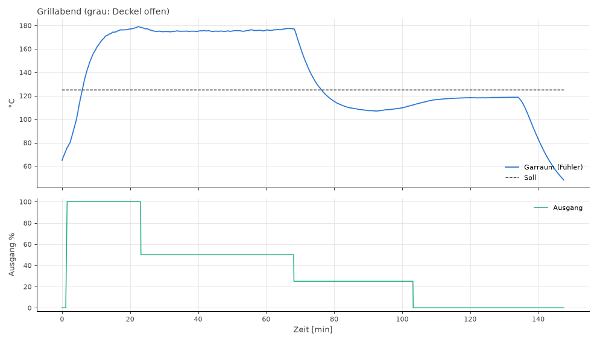

# Stufentest 2026-10-30 (El Fuego, erster Lauf mit Gas)

Handbetrieb mit festen Servo-Stufen, um die Strecke zu vermessen. Kein Grillgut.

## Aufbau

- Profil 4 „Gas Servo“, SPmin 0, SPmax 45 (100 % ≈ 80° am Ventil, Min→Max ≈ 90°)
- Fühler 1 Mitte (Regelkanal), Fühler 2 unten über der Wasserschale, Fühler 3 ganz oben
- Wasserschale voll zu Beginn, Garage 10–12 °C, Tor offen, Deckel die ganze Zeit zu
- Mitschrieb `GET /data` alle 5 s: [stufentest_5s.csv](stufentest_5s.csv) (Cloud-Format,
  Spalten wie `tools/analyze_cook.py` sie liest, plus `flameOut`, `lid`, `soc`, `rssi`)

## Ablauf

| Uhrzeit | Servo | Bemerkung |
|---|---|---|
| 20:34 | 0 % | Smoker schon gezündet, Fühler 1 bei 65 °C |
| 20:35:29 | 100 % | 20:36:43–20:38:28 keine Daten (Gerät lief am Akku, schwaches WLAN) |
| 20:57:25 | 50 % | |
| 21:42:24 | 25 % | 21:47 Fehlalarm „Flamme aus“ des Mitschreibers (Flamme brannte) |
| ca. 22:05 | 25 % | Wasserschale leer (ab hier „trocken“) |
| 22:17:28 | 0 % | |
| 22:48:20 | – | Gas von Hand zu, danach Abkühlen mit geschlossenem Deckel bis 23:02 |

## Ergebnisse (Fühler 1)

| Servo | eingeschwungen | Wasser |
|---|---|---|
| 100 % | ~176–178 °C (Spitze 179 °C, als das Wasser zu kochen begann) | ja |
| 50 % | ~175,5 °C | ja |
| 25 % | ~107 °C (Minimum 22:06) | knapp |
| 0 % | ~118,7 °C | leer |
| Gas aus | 118,7 → 51,7 °C in 13 min | leer |

- **Sättigung:** Oberhalb von etwa 50 % Servo kommt kaum noch Wärme dazu (2–3 °C). Ob das am Ventil
  liegt oder an der kochenden Wasserschale, die bei mehr Gas mehr verdampft, trennt dieser Lauf nicht.
- **Zeitkonstante:** nach Gasänderungen ≈ 6 min bis 63 %; Abkühlen ohne Flamme ≈ 12 min.
- **Wasser:** Die volle Schale hält bei 100–180 °C etwa 1,5 h. Ohne Wasser liegt der Garraum bei
  gleichem Gas deutlich höher (0 % trocken 118,7 °C > 25 % nass 107 °C).
- **Verteilung:** Bei viel Gas sind Mitte und oben fast gleich (±4 °C), unten über dem Wasser
  35–40 °C kühler. Bei 25 % liegen alle drei Ebenen innerhalb von 2 °C.
- **Flammenausfall:** Der Schritt 50 → 25 % ließ Fühler 1 in 5 min um 36 °C fallen, genauso schnell
  wie nach echtem Gas-aus. Eine reine Fallgeschwindigkeits-Schwelle unterscheidet das nicht.
- **WLAN:** RSSI −67 bis −87 dBm in der Garage; am Akku antwortete das Gerät zeitweise nicht.

## Folgerungen

- SPmax 45 → 25 (mit dem Nutzer abgestimmt, noch nicht gesetzt), damit der wirksame Bereich den
  ganzen Regelweg nutzt.
- Vor dem Autotune prüfen, ob die Flammenausfall-Erkennung nach Schritten nach unten
  (Relay-Autotune, Sollwert senken) Fehlalarme auslöst.

## Streckenmodell aus diesem Lauf

`tools/fit_plant.py --csv fit_mit_wasser_5s.csv --fix tMin=95` (nur der Teil mit Wasser,
20:38–22:05; das Modell kennt keine Wasserschale):

| Parameter | Wert | Bemerkung |
|---|---|---|
| Totzeit L | 63 s | nur L + Fühler (≈ 68 s) ist belastbar |
| τ Garraum | 272 s | |
| tMin (0 %) | 95 °C | festgesetzt: ohne 0 %-Phase mit Wasser nicht bestimmbar (25,8 °C passt genauso gut, ist aber unplausibel) |
| tMax | 180 °C | |
| valveExp | 2,54 | unten flach: zwischen 0 und ~25 % tut sich wenig |
| valveSat | 51 % | darüber keine Mehrleistung |
| Fühler | 4,7 s | |

RMSE 1,4 °C (vorher ohne Sättigung 12,5 °C; P1–P3: 23–58 °C). Dateien:
`test/sim/plants/elfuego-2026-10-30.plant` (SPmax 45) und `…-sp25.plant` (gleiche Strecke für
SPmax 25: valveSat 51 % × 45/25 = 92 %).

## Simulation der Firmware mit diesem Modell (CI, `make -C test/sim plants`)

| Modell | Modus | 110 °C | 150 °C |
|---|---|---|---|
| SPmax 45 | alt | hält ±1,3 °C, Sprung +20 ok, Flamme aus nach 222 s | hält nur ±4,2 °C |
| SPmax 45 | smart | hält ±15 °C, Deckel-Fehlalarm | Überschwingen 9,5 °C |
| SPmax 25 | alt | hält ±0,7 °C, Flamme aus nach 129 s, Autotune 62,6 min | Autotune bricht ab (Fehler 9) |
| SPmax 25 | smart | hält ±0,6 °C, Überschwingen 3,9 °C | Autotune bricht ab (Fehler 9) |

- SPmax 25 verbessert die Regelung deutlich; mit SPmax 45 versagt vor allem der Smart-Modus.
- Autotune bei 150 °C mit SPmax 25: Die Bias-Schätzung bleibt bei 50 %, das Relais (±20 %)
  erreicht 150 °C nicht (Strecke braucht dort ≈ 78 %), Abbruch „keine Schwingung“. Autotune
  deshalb vorerst bei 110–130 °C machen. Bei 130 °C reicht das Relais rechnerisch (50 ± 20 % →
  100–137 °C), in der Simulation ist 130 °C aber noch nicht gerechnet.
