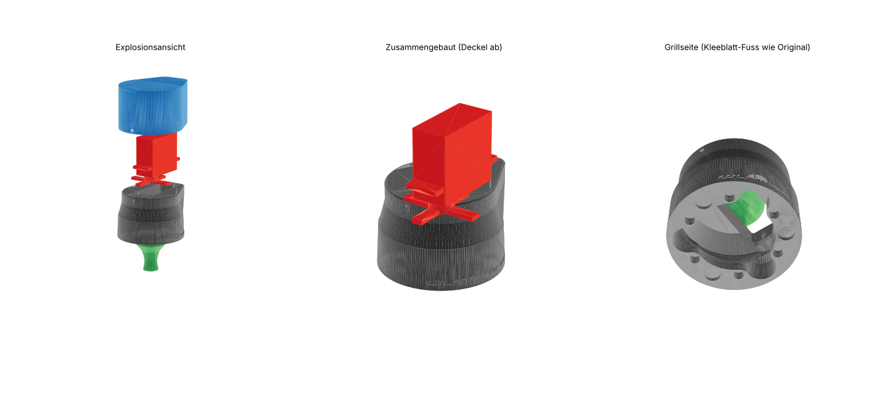

# Pitmaster AddOn El Fuego Portland – MG995-Variante (Entwurf v1)

Umbau des WLANThermo Pitmaster AddOn für den El Fuego Portland Gas Smoker
vom SG90 auf den **MG995** (10 kg·cm bei 6 V, 180°).



## Was übernommen wird und was neu ist

| Teil | Übernommen vom Original | Neu |
|---|---|---|
| `Gehaeuse_MG995.stl` | Fuß bis 22 mm Höhe, volumengenau gleich: Kleeblatt-Aufnahme um die Knopfblende, 5 Magnete, 3 Gummifüße, Schriftzug | Tropfenförmige Haube mit Montageplatte für den MG995. Der Servo wird von oben eingesetzt, Welle nach unten, und mit 4 Schrauben durch die Laschen befestigt. Langlöcher ±1,5 mm fangen Toleranzen im Lochabstand ab. |
| `Deckel_MG995.stl` | – | Haube über dem herausstehenden Servorücken, mit Loch für die Tiny-XLR-Buchse (Ø 6,5 wie beim Original). Wird mit 2× M3 seitlich gehalten. |
| `Kupplung_MG995.stl` | Unterteil mit D-Aufnahme für die Ventilachse, bis 19,5 mm volumengenau gleich | Kopf Ø 30 mit 4 Klauen für das MG995-Kreuzhorn. Länge 32 statt 25 mm. |

Warum die Haube asymmetrisch ist: Beim MG995 sitzt die Abtriebswelle etwa 10 mm
außermittig, und über die Laschen ist er 54,5 mm lang. Damit die Welle genau
über der Ventilachse sitzt, ragt der Servokörper zu einer Seite aus dem runden
Gehäuse heraus. Diese Seite zeigt standardmäßig in dieselbe Richtung, in die
auch der SG90 im Original zeigte (Parameter `SERVO_DIR_DEG`).

Höhe ab Grillfront: Gehäuse 44,5 mm, mit Deckel ≈ 79 mm (Original: 57 mm).

## Bitte nachmessen

Die Werte im Skript sind typische Maße für Normservos. MG995-Klone weichen
voneinander ab. Bitte am eigenen Servo messen und mir schicken, oder direkt
oben in `generate.py` eintragen:

| Parameter | Standardwert | Was messen |
|---|---|---|
| `SERVO_L` / `SERVO_W` | 40,8 / 20,0 | Länge und Breite des Gehäuses ohne Laschen |
| `SERVO_SHAFT_FROM_END` | 10,2 | Mitte der Abtriebswelle bis zur nächsten Stirnseite |
| `SERVO_TAB_SPAN` | 54,5 | Länge über beide Laschen |
| `SERVO_HOLE_PITCH` × `_W` | 49,5 × 10 | Lochabstand längs × quer (Mitte–Mitte) |
| `TAB_TO_HORN` | 15,5 | **Wichtigstes Maß:** von der wellenseitigen Laschenfläche bis zur Unterkante des aufgesteckten Kreuzhorns |
| `TAB_TO_BOTTOM` | 29,5 | von der wellenseitigen Laschenfläche bis zum Servoboden |
| `HORN_ARM_W` | 6,0 | Breite der Hornarme nahe der Nabe |
| `HORN_HUB_D` | 13,0 | Durchmesser der Hornnabe |
| `HORN_SWEEP_R` | 21,0 | längster Arm, gemessen von der Wellenmitte |

Außerdem vom bisherigen Aufbau:

- `COUPLER_Z0` (0,5): wie weit die Unterkante der alten Kupplung von der Grillfront entfernt ist.
- Was liegt rund um den Gasknopf? Die Tropfenspitze ragt bis 41 mm aus der Mitte heraus. Falls dort der Zündknopf oder eine Kante im Weg ist, `SERVO_DIR_DEG` drehen.

## Neu erzeugen

```bash
pip install manifold3d trimesh numpy
python3 generate.py
```

Das Skript prüft beim Erzeugen gegen einen MG995-Dummy, dass sich Servo, Horn,
Kupplung, Gehäuse und Deckel nicht überschneiden. Es gibt die Ergebnisse aus
(`Kollisionspruefung`). `stl/_Baugruppe_ohne_Deckel.stl` zeigt die Teile zur
Kontrolle in Einbaulage und wird nicht gedruckt.

## Druck

Die STLs liegen schon in Druckorientierung vor. Alle drei Teile drucken ohne Stützen.

- Gehäuse: Montageplatte auf dem Bett, so wie das Original mit dem Deckel nach unten gedruckt wurde.
- Deckel: Oberseite auf dem Bett.
- Kupplung: Fuß auf dem Bett.
- 0,15–0,2 mm Schichthöhe, 35 % Infill, 3–4 Perimeter (der Servo hat ~5× mehr Kraft als der SG90).
- Material: PETG oder ASA. PLA wird in der Nähe der Brennkammer weich.

## Laut AZ-Delivery-Datenblatt (AZ225)

- Abmessungen nur grob: 40 × 19 × 42 mm. Eine Maßzeichnung gibt es nicht, deshalb bleibt die Messliste oben nötig.
- Zubehör: Kreuzhorn (4 Arme), Doppelarm, Rundscheibe, Stern (6 Arme), 4 Gummitüllen, 4 Messinghülsen, 4 Befestigungsschrauben, 1 Hornschraube.
- Kabel: braun = GND, rot = VCC, orange = Signal. 4,8–7,2 V.
- Betriebstemperatur nur **0–55 °C**: Das Gehäuse darf am Grill nicht heiß werden.
- Drehwinkel: Die Tabelle sagt 120°, der Text 180°. Die Endlagen deshalb am Ventil ausprobieren.
- **Gummitüllen weglassen:** Der Servo wird direkt auf die Platte geschraubt. Mit Tüllen hat er Spiel, und `TAB_TO_HORN` verschiebt sich um die Tüllendicke.

## Stückliste

- 1× MG995 mit Kreuzhorn (Zubehör)
- 4× M3×10 (oder Blechschraube 2,9×9,5) für die Servolaschen, Kernloch Ø 2,7
- 2× M3×8 für den Deckel
- 5× Magnet Ø 5×5 mm, 3× Gummifuß Ø 8×2,5 mm (wie Original)
- 1× Tiny-XLR-Buchse und Kabel (wie Original)

## Hinweise zur Elektronik

- **Strom:** Der MG995 zieht beim Anlaufen und Blockieren deutlich über 1 A, der SG90 nur einige 100 mA. Wenn der Nano V3 beim Verstellen neu startet oder der Servo zittert, braucht der Servo eine eigene 5–6-V-Versorgung mit gemeinsamer Masse.
- **Pulsbreiten:** Die Firmware lässt 400–2600 µs zu (`servoDcMin/servoDcMax`, Standard 550/2250 µs). Für den MG995 sind meist 500–2500 µs passend. Die Endlagen am Gasventil neu einstellen, damit der Servo nicht gegen den Anschlag drückt.
