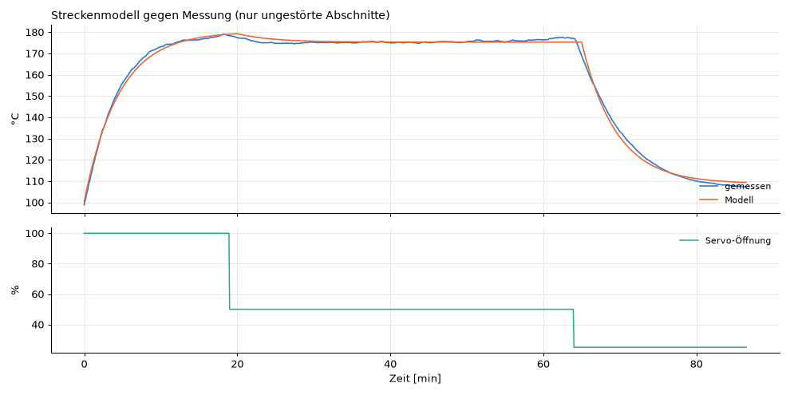

# Streckenmodell elfuego-2026-10-30

RMSE 1.408 °C über 86.6 min ungestörte Abschnitte [86.6].

| Parameter | angepasst | P1 | P2 | P3 |
|---|---|---|---|---|
| deadTimeS | 62.969 | 20 | 40 | 60 |
| tauS | 272.416 | 240 | 420 | 600 |
| tMin | 95.0 | 70 | 75 | 80 |
| tMax | 180.23 | 220 | 250 | 280 |
| valveExp | 2.541 | 0.5 | 0.5 | 0.5 |
| tauSensorS | 4.74 | 10 | 20 | 30 |
| valveSat | 51.181 | 100 | 100 | 100 |

RMSE der Referenzmodelle auf denselben Daten: P1 22.76 °C, P2 39.485 °C, P3 58.467 °C

